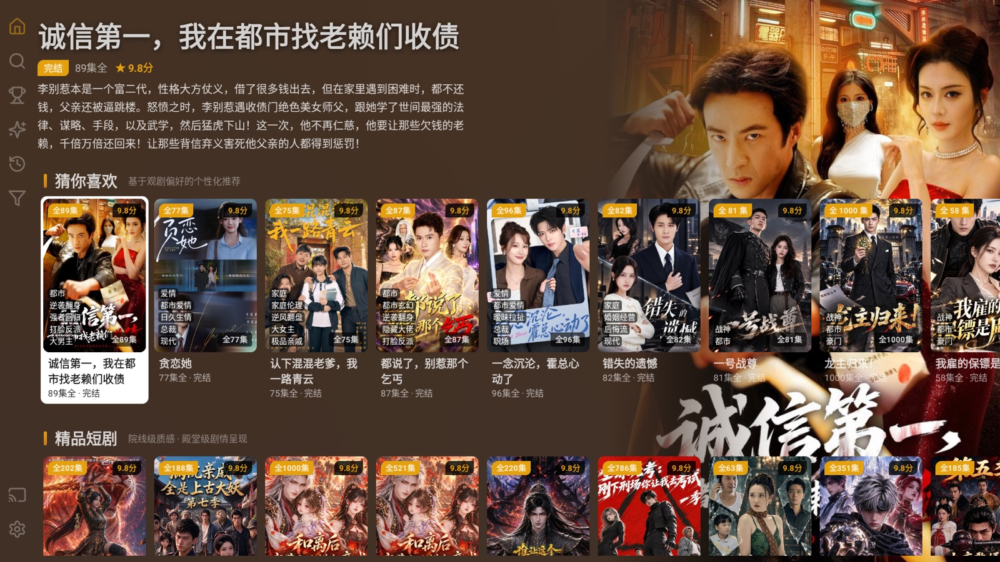
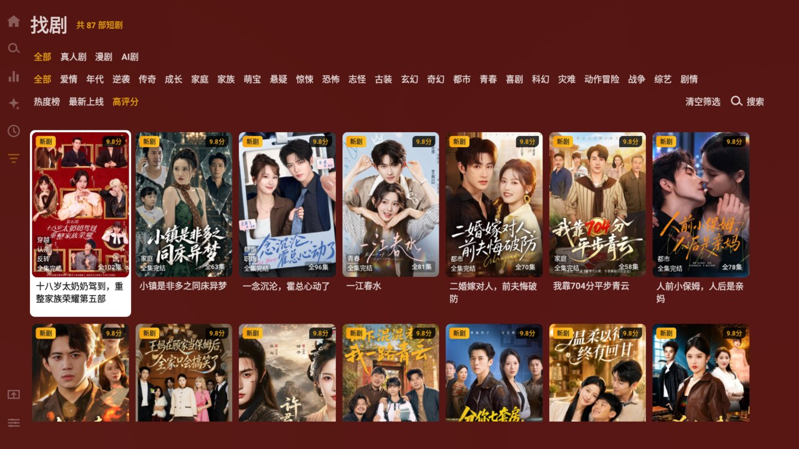
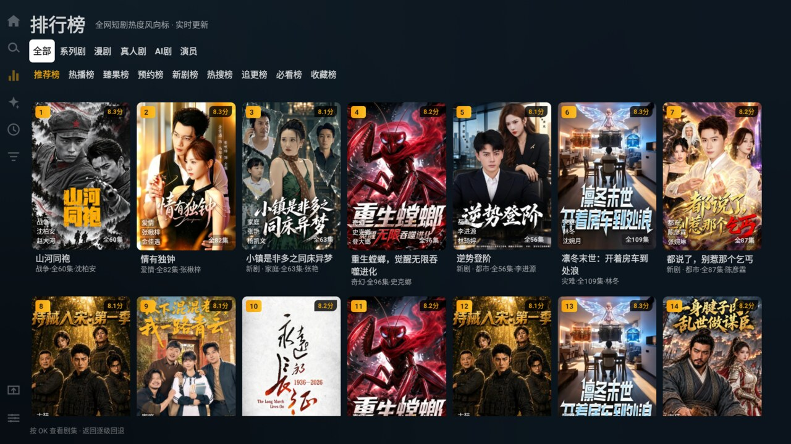
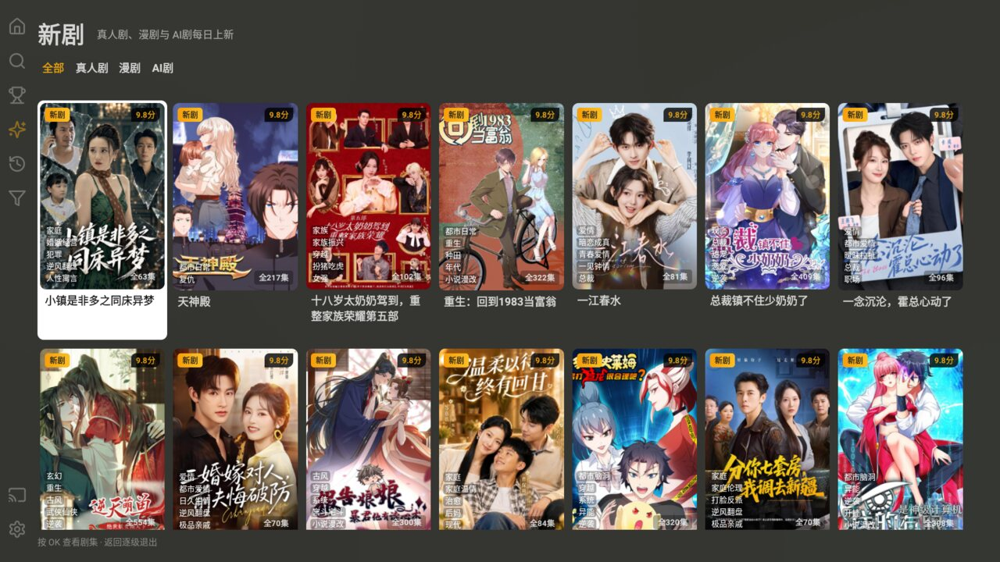
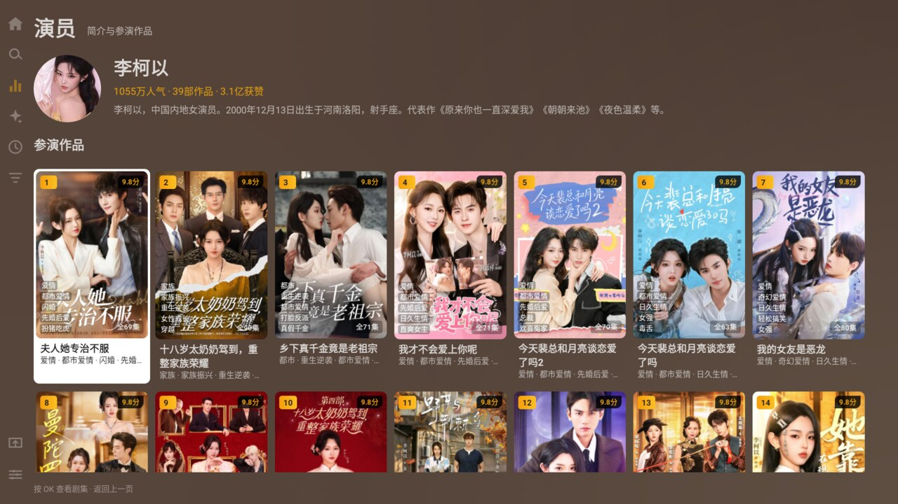
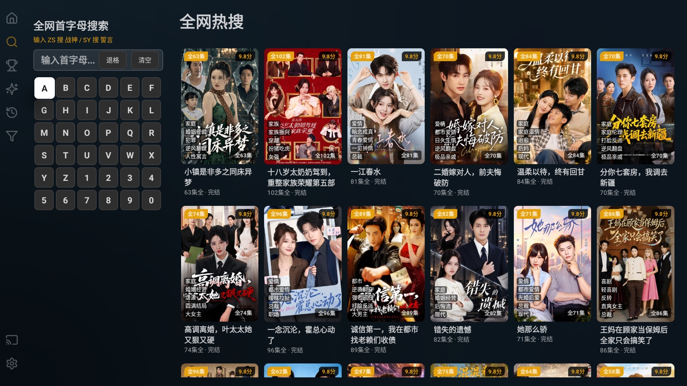
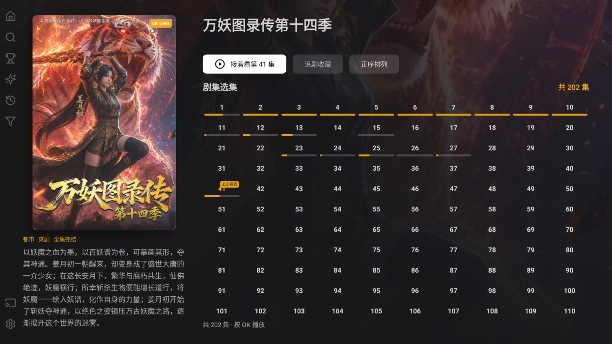
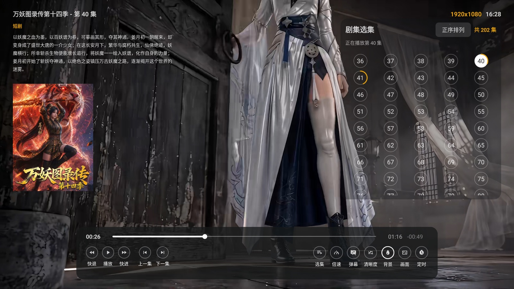
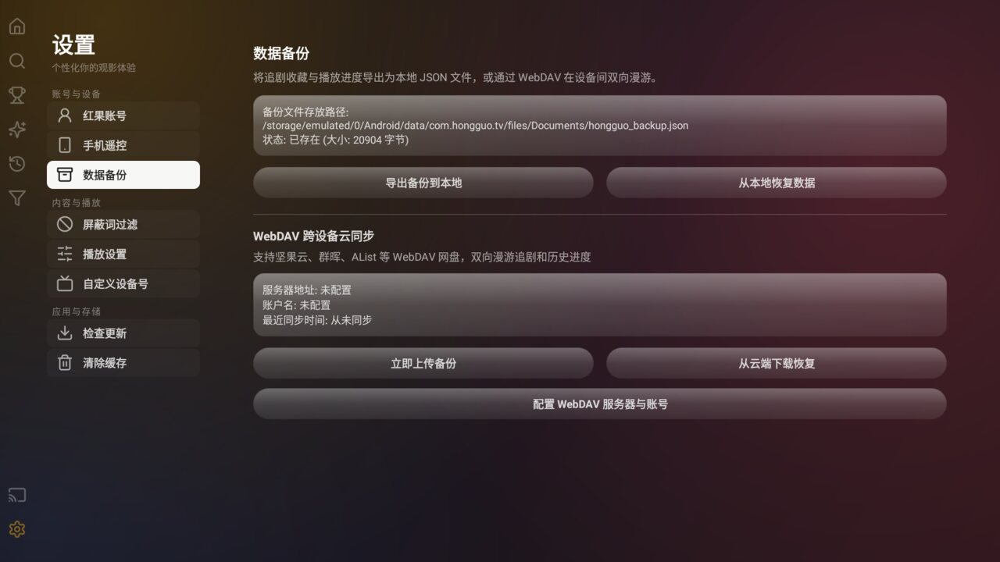

# 红苹果短剧TV

**沉浸式视觉体系 + 短剧内容聚合的电视端播放器**

[-green.svg?style=flat-square)](https://android.com)

---

## 界面截图

| 首页 · 封面 artwork + 动态背景 | 找剧 · 筛选标签自动换行 | 榜单 · 排名角标与统一卡片 |
| :---: | :---: | :---: |
|  |  |  |

| 新剧 · 分类筛选 | 榜单 · 演员详情（简介 + 参演作品） | 搜索 · 首字母键盘与全网热搜 |
| :---: | :---: | :---: |
|  |  |  |

| 详情 · 胶囊按钮与集数网格 | 播放器 · OSD 完整封面 | 设置 · 账号同步与分类菜单 |
| :---: | :---: | :---: |
|  |  |  |

